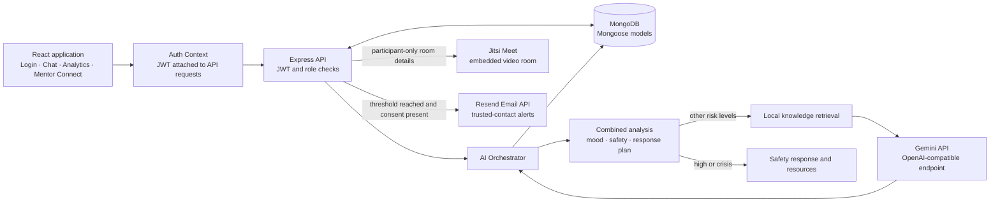
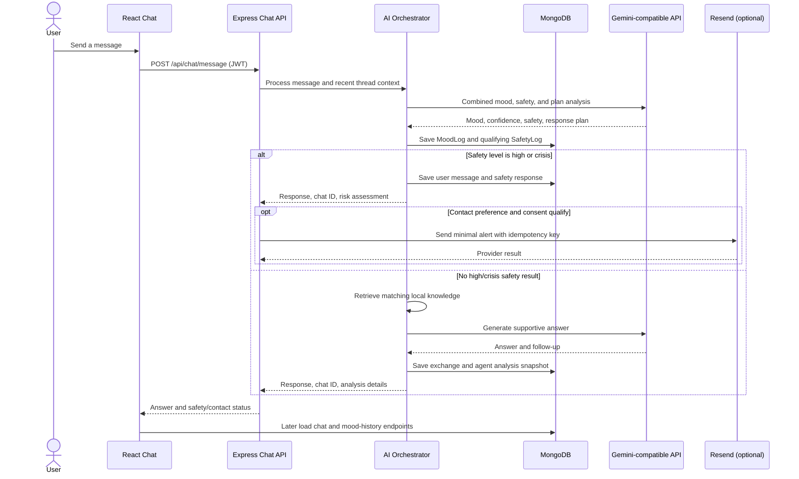
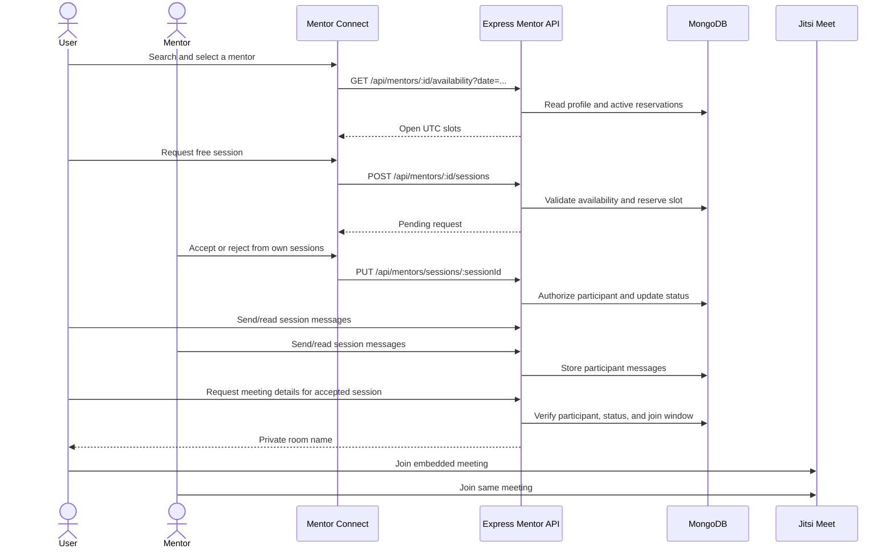

# Solace 2.0

**An AI-assisted wellbeing companion with private mood tracking and human mentor support.**

Solace combines conversational support, emotional-pattern analytics, and free mentor sessions in one web application. Users can talk with the Solace assistant, revisit past conversations and their analysis, discover mentors, request sessions, chat with a session participant, and join an embedded video meeting after a request is accepted.

> **Important:** Solace is an educational wellbeing-support project. It does not diagnose, provide medical treatment, or replace professional or emergency care. AI mood and safety assessments may be inaccurate. In immediate danger, contact local emergency services.

---

## Contents

- [What Solace includes](#what-solace-includes)
- [System architecture](#system-architecture)
- [How the main flows work](#how-the-main-flows-work)
- [Technology](#technology)
- [Repository structure](#repository-structure)
- [Run locally](#run-locally)
- [Deploy to Vercel](#deploy-to-vercel)
- [Environment configuration](#environment-configuration)
- [Presentation demo data](#presentation-demo-data)
- [API reference](#api-reference)
- [Data model](#data-model)
- [Privacy and implementation boundaries](#privacy-and-implementation-boundaries)
- [Troubleshooting](#troubleshooting)
- [Further documentation](#further-documentation)

## What Solace includes

### Accounts and roles

- Existing email/password accounts continue to use JWT authentication; existing users do not need to register again.
- Signup supports User and Mentor role selection. The signup fields use stable controlled components so typing does not lose focus after each character.
- User and mentor routes enforce role-specific access on the server as well as in the UI.

### Solace AI chat

- Private, authenticated conversations saved to MongoDB.
- Mood classification with confidence and indicators for each user message.
- Safety assessment with a dedicated response path for high or crisis results.
- Retrieval-augmented responses using the project’s local wellbeing knowledge base.
- A response plan, supportive answer, follow-up prompt, resources, and processing time.
- Expandable historical analysis attached to assistant replies.
- Fallback responses when the configured language model is unavailable.

### Mood analytics

- Mood distribution and daily trend views for 7, 14, and 30 days.
- Confidence, coverage, conversation-depth, and pattern summaries.
- Mood logs linked back to the conversation that produced them.

### Mentor Connect

- Separate user and mentor roles, using the existing account and JWT authentication flow.
- Mentor profiles with background, mentor type, expertise, languages, approach, availability, and session length.
- Peer wellbeing mentors are distinguished from self-described qualified professionals. Credentials are self-reported and are not verified by Solace.
- Profiles are published when the mentor saves them; there is no review queue in the current implementation.
- Users can search and filter profiles, inspect availability, and request a **free** session.
- Session states: `pending`, `accepted`, `rejected`, `cancelled`, and `completed`.
- Session-specific user/mentor chat, refreshed by REST polling every five seconds.
- Jitsi Meet room embedded for accepted sessions. Normal sessions enforce the scheduled join window.

### Trusted contacts

- Users can save up to five trusted contacts and choose a safety threshold.
- Listing a person and opting them into email alerts are separate consent choices.
- If an enabled threshold is reached, Solace can submit a minimal email through Resend. It does not include the user's message or chat history.
- Duplicate alerts to the same contact in the same chat thread are suppressed.
- The UI reports whether Resend accepted the request; this does not confirm inbox delivery. Solace does not send SMS messages or place calls.

## System architecture



The application is split into a React client and an Express server. The server owns authorization, AI orchestration, booking validation, contact notification, and database access. The browser never receives database credentials, Gemini keys, or the Resend API key.

## How the main flows work

### AI chat and mood analytics



1. The API authenticates the user and the orchestrator loads up to ten recent messages from the selected thread.
2. A combined analysis returns mood, safety, and a response plan. The safety service also applies its configured keyword/heuristic floor.
3. A mood record is stored for the user message. Non-`none` safety assessments are recorded separately.
4. High or crisis results take the safety response path. Other results use local retrieval and response generation through the configured Gemini-compatible endpoint. Template responses are available as a fallback.
5. The user and assistant messages are stored in `Chat`. Assistant replies retain the analysis snapshot used by the chat UI.
6. Analytics endpoints aggregate `MoodLog` records by mood and date; they do not need to load full conversation bodies.

The local RAG implementation ranks knowledge-base entries with keyword and Jaccard-style similarity. It does **not** call an embedding service. The current context window is recent messages from the active thread; there is no standalone long-term Memory Agent.

### Mentor booking, chat, and video



The booking controller validates a future UTC slot against the mentor’s recurring schedule and checks for overlaps. A MongoDB partial unique index provides a second guard against concurrent reservations of the same mentor/start time. Pending and accepted bookings hold a slot; rejected, cancelled, and completed sessions release it.

Mentor chat is tied to a session, not a general direct-message feature. The server checks session participation on each read and send. Video uses Jitsi’s hosted meeting service; Solace does not implement its own WebRTC signaling server. The meeting room name is returned only to an authorized participant of an accepted session. Demo accepted sessions intentionally bypass the scheduled time window for presentations.

## Technology

| Layer | Technologies |
|---|---|
| Frontend | React 19, React Router, Axios, Create React App, Tailwind configuration, custom CSS |
| Backend | Node.js, Express, Mongoose, JWT, bcrypt |
| Database | MongoDB |
| AI | Gemini API through its OpenAI-compatible endpoint and the OpenAI Node client |
| Video | Jitsi Meet External API, with Jitsi handling the meeting transport |
| Trusted-contact email | Resend Email API |

## Repository structure

```text
AgenticAi/
├── README.md                              # Main setup and technical overview
├── PROJECT_PRESENTATION_GUIDE.md          # Detailed report and professor Q&A
├── .gitignore
├── client/
│   ├── .env.example                       # Browser-visible configuration template
│   ├── package.json                       # React scripts and client dependencies
│   ├── package-lock.json
│   ├── postcss.config.js
│   ├── tailwind.config.js
│   ├── public/
│   │   ├── favicon.svg
│   │   ├── index.html                      # CRA HTML shell
│   │   ├── manifest.json
│   │   └── robots.txt
│   └── src/
│       ├── index.js                        # React DOM entry; mounts App.jsx
│       ├── App.jsx                          # Routes, auth guards, shared layout
│       ├── App.js                           # Compatibility re-export of App.jsx
│       ├── index.css                        # Design tokens, page and component styles
│       ├── reportWebVitals.js                # CRA performance hook
│       ├── setupTests.js                    # CRA test environment setup
│       ├── context/
│       │   └── AuthContext.jsx               # Login, signup, JWT, current user
│       ├── services/
│       │   └── api.js                        # Axios client and API functions
│       ├── components/
│       │   ├── Navbar.jsx                    # Main application navigation
│       │   ├── ChatBoxView.jsx               # AI chat list, composer, message flow
│       │   ├── MessageBubbleView.jsx         # AI message, safety, agent snapshot UI
│       │   ├── MessageBubble.jsx              # Earlier message renderer; current chat uses MessageBubbleView
│       │   └── SessionChat.jsx                # Mentor session participant chat
│       └── pages/
│           ├── Login.jsx                     # Login and optional demo quick-fill
│           ├── Signup.jsx                    # User/mentor role registration
│           ├── Home.jsx                      # User dashboard
│           ├── Chat.jsx                      # AI chat, thread history, mood panel
│           ├── MoodAnalytics.jsx             # 7/14/30-day mood analytics
│           ├── MentorConnect.jsx             # Discovery, sessions, safety settings
│           ├── MentorOnboarding.jsx           # Mentor profile create/edit
│           ├── MeetingRoom.jsx                # Authorized Jitsi meeting embed
│           ├── Chat.js                        # Compatibility re-export of Chat.jsx
│           ├── Login.js                       # Compatibility re-export of Login.jsx
│           ├── Signup.js                      # Compatibility re-export of Signup.jsx
│           ├── History.js                     # Older localStorage history page
│           └── Planner.js                     # Older planner prototype
└── server/
    ├── .env.example                          # Server configuration template
    ├── package.json                          # Backend scripts and dependencies
    ├── package-lock.json
    ├── scripts/
    │   └── seed-demo.js                      # Idempotent fictional presentation data
    └── src/
        ├── server.js                         # Active server entry; loads .env and MongoDB
        ├── app.mjs                           # Active Express app and route mounting
        ├── app.js                             # Vercel-compatible adapter to the active Express app
        ├── app.legacy.js                      # Preserved older CommonJS app configuration
        ├── config/
        │   ├── db.js                          # MongoDB connection
        │   ├── llm.js                         # Gemini-compatible LLM client and fallback
        │   └── swagger.config.mjs             # OpenAPI configuration
        ├── middlewares/
        │   └── auth.middleware.js             # JWT authentication and role checks
        ├── routes/
        │   ├── auth.routes.js                 # Signup, login, profile, logout
        │   ├── chat.routes.js                 # AI chat, history, mood history
        │   ├── user.routes.js                 # Profile, password, safety preferences
        │   └── mentor.routes.js               # Profiles, availability, sessions, chat, video
        ├── controllers/
        │   ├── auth.controller.js             # Account lifecycle and JWT responses
        │   ├── chat.controller.js             # Chat API and contact-email trigger
        │   ├── user.controller.js             # User settings and profile
        │   └── mentor.controller.js           # Mentor/session authorization and logic
        ├── models/
        │   ├── User.js                        # Accounts, roles, trusted contacts
        │   ├── Chat.js                        # AI conversation and agent snapshots
        │   ├── MoodLog.js                     # Timestamped mood observations
        │   ├── SafetyLog.js                   # Safety events and follow-up status
        │   ├── MentorProfile.js               # Mentor bio, expertise, availability
        │   ├── MentorSession.js               # Booking state and slot reservation
        │   ├── MentorMessage.js                # Session-scoped human chat messages
        │   └── TrustedContactNotification.js  # Email status and deduplication data
        ├── services/
        │   ├── orchestrator.service.js        # Coordinates the AI message pipeline
        │   ├── trusted-contact-email.service.js # Resend call and email idempotency
        │   ├── ai/
        │   │   ├── analysis.service.js        # Combined mood/safety/plan analysis
        │   │   ├── mood.service.js            # Mood labels and normalization
        │   │   ├── safety.service.js          # Heuristics, safety response, resources
        │   │   ├── planner.service.js          # Response-planning prompts/rules
        │   │   └── response.service.js        # Generated and fallback responses
        │   └── rag/
        │       ├── knowledge-base.js           # Local wellbeing source material
        │       └── rag.service.js              # Similarity ranking and retrieval
        └── utils/
            └── helpers.js                      # Shared text and numeric utilities
```

`.env` files and generated `node_modules/` and `build/` folders are intentionally not part of the source tree. The `App.js`, `Chat.js`, `Login.js`, and `Signup.js` files are compatibility re-exports; the current entry and router import the `.jsx` modules. `History.js`, `Planner.js`, and `MessageBubble.jsx` are older components not mounted by the active routes/chat view.

## Run locally

### Requirements

- Node.js 18 or newer and npm.
- MongoDB running locally or a MongoDB Atlas connection string.
- A Gemini API key for live model-generated responses. Without it, the assistant can use its fallback behavior, but not the configured live model.
- Optional: a Resend account and authorized sender configuration for trusted-contact email.

### 1. Install dependencies

Run these from separate terminals or in sequence:

```bash
cd server
npm install
```

```bash
cd client
npm install
```

### 2. Configure environment files

Create `server/.env` from `server/.env.example` and set the required values described below. Create `client/.env` from `client/.env.example` if client settings need to be changed.

### 3. Start MongoDB and the API

```bash
cd server
npm run dev
```

The API starts at `http://localhost:5000` by default. Confirm it is responding at [`http://localhost:5000/api/health`](http://localhost:5000/api/health). Interactive API docs are served at [`http://localhost:5000/api-docs`](http://localhost:5000/api-docs).

### 4. Start the web client

In another terminal:

```bash
cd client
npm start
```

The development client opens at `http://localhost:3000`. If you change a `REACT_APP_*` value, restart the client so Create React App reloads that build-time setting. If you change server environment values, restart the API.

### Production frontend build

```bash
cd client
npm run build
```

## Deploy to Vercel

Solace is a client/server monorepo and should be deployed as two Vercel projects linked to this same Git repository. This keeps the Create React App static build separate from the Express API while preserving the existing architecture.

Current production deployments: [Solace web app](https://solace-frontend-drab.vercel.app) · [API health](https://solace-api-sigma.vercel.app/api/health).

### Frontend project

1. Import the repository in Vercel and set **Root Directory** to `client`.
2. Vercel uses `client/vercel.json` to run `npm run build`, publish `build`, and serve client-side routes through `index.html`.
3. Add `REACT_APP_API_URL` as a build environment variable, set to the deployed API origin followed by `/api` (for example, `https://solace-api-your-team.vercel.app/api`).
4. Add `REACT_APP_DEMO_MODE` only if demo quick-fill buttons should be enabled in the public build.

### API project

1. Import the same repository again as a second Vercel project and set **Root Directory** to `server`.
2. Vercel detects the Express adapter in `src/app.js`, which forwards to the maintained app in `src/app.mjs`. Database connection is initialized on demand and reused in warm serverless instances; `/api/health` stays available as a lightweight health check.
3. Configure these server environment variables in Vercel **without** a `REACT_APP_` prefix:
   - `MONGODB_URI`
   - `JWT_SECRET` (use a long, unique production secret)
   - `GEMINI_API_KEY` (needed for live AI responses)
   - `FRONTEND_URL` (the exact deployed frontend origin, with no `/` path)
   - `RESEND_API_KEY` and `TRUSTED_CONTACT_FROM_EMAIL` if trusted-contact email alerts should be enabled
4. Allow the Vercel API deployment to connect to MongoDB Atlas by configuring Atlas network access for the deployment. Keep database credentials and API keys only in Vercel's server-side environment settings.
5. Deploy the API, copy its production origin into the frontend's `REACT_APP_API_URL`, then deploy the frontend. Redeploy the frontend whenever that build-time API URL changes.

The app uses Jitsi for meeting rooms; mentor booking and session messaging are handled by the API and MongoDB. Vercel deployment does not provision MongoDB, Gemini, or Resend accounts. Configure production and preview environment values deliberately because the API's CORS policy allows the origin in `FRONTEND_URL`.

For CLI deployments, link `client` and `server` as separate Vercel projects and run `vercel --prod` from each project directory. Do not commit `.env` files or paste production secrets into the repository.

## Environment configuration

### Backend: `server/.env`

| Variable | Required | Purpose |
|---|---:|---|
| `PORT` | No | API port; defaults to `5000` |
| `NODE_ENV` | No | Runtime mode, such as `development` or `production` |
| `MONGODB_URI` | Yes | MongoDB connection string |
| `JWT_SECRET` | Yes | Secret used to sign and verify auth tokens; use a unique, long value |
| `GEMINI_API_KEY` | For live AI | API key for the configured Gemini-compatible model endpoint |
| `GEMINI_MODEL` | No | Primary model; defaults in code to `gemini-2.5-flash-lite` |
| `GEMINI_FALLBACK_MODEL` | No | Quota fallback; defaults in code to `gemini-2.0-flash-lite` |
| `GEMINI_BASE_URL` | No | Gemini OpenAI-compatible base URL |
| `GEMINI_FALLBACK_COOLDOWN_MS` | No | Cooldown before retrying the primary model after a quota error |
| `FRONTEND_URL` | No | Allowed CORS origin; defaults to `http://localhost:3000` |
| `RESEND_API_KEY` | For email alerts | Resend secret API key; keep it server-side |
| `TRUSTED_CONTACT_FROM_EMAIL` | For email alerts | Sender address authorized with Resend |

To enable Resend, add the API key and an authorized sender. A `resend.dev` test sender is suitable for development testing and may be restricted to your own account recipient. Sending alerts to other people generally requires a sender domain verified with Resend. Email is attempted only when safety preferences, threshold, and contact email consent all qualify.

### Frontend: `client/.env`

| Variable | Required | Purpose |
|---|---:|---|
| `REACT_APP_API_URL` | Yes | API root, usually `http://localhost:5000/api` |
| `REACT_APP_DEMO_MODE` | No | Set to `true` to show demo login quick-fill buttons |

Never put database, JWT, Gemini, or Resend secrets in a `REACT_APP_*` variable; frontend variables are bundled into browser code.

## Presentation demo data

Seed the database configured in `server/.env`:

```bash
cd server
npm run seed:demo
```

The repeatable seed creates fictional demo accounts, mentor profiles, bookings in multiple states, human mentor-session conversations, and 18 AI chat threads across 29 days with linked mood records. Seeded records are marked as demo; the script refuses to take over non-demo accounts, mentor profiles, sessions, or chats.

Demo sign-in credentials:

| Role | Login | Password |
|---|---|---|
| User | `demo.user@solace.local` | `SolaceDemo!2026` |
| Mentor | `demo.mentor.maya@solace.local` | `SolaceDemo!2026` |
| Other mentor examples | `demo.mentor.rohan@solace.local`, `demo.mentor.leela@solace.local` | `SolaceDemo!2026` |

These credentials are for local demonstrations only. Do not reuse the seed password or demo records in a production deployment. Demo conversations are fictional examples, not actual users or live model-generated responses.

## API reference

All API paths below are prefixed with `/api`. Routes marked **JWT** require a valid bearer token. The API also exposes an OpenAPI document at `/api-docs.json` and an interactive viewer at `/api-docs`.

### System

| Method | Path | Access | Purpose |
|---|---|---|---|
| `GET` | `/health` | Public | API health and server timestamp |

### Authentication

| Method | Path | Access | Purpose |
|---|---|---|---|
| `POST` | `/auth/signup` | Public | Create a user or mentor account |
| `POST` | `/auth/login` | Public | Authenticate and return a JWT |
| `GET` | `/auth/me` | JWT | Read the current account |
| `POST` | `/auth/logout` | JWT | Client-side token logout endpoint |

### AI chat and mood history

| Method | Path | Access | Purpose |
|---|---|---|---|
| `POST` | `/chat/message` | JWT user | Run analysis and return an assistant response |
| `GET` | `/chat/history?limit=20` | JWT user | List the account’s saved threads |
| `GET` | `/chat/:chatId` | JWT owner | Read one conversation and its messages |
| `GET` | `/chat/mood-history?days=30` | JWT user | Return mood distribution and daily trend |
| `POST` | `/chat/new` | JWT user | Start a blank thread; first message creates it |

Mentor accounts are intentionally excluded from AI chat and mood-history routes.

### User settings

| Method | Path | Access | Purpose |
|---|---|---|---|
| `GET` | `/user/profile` | JWT | Read user profile |
| `PUT` | `/user/profile` | JWT | Update user profile |
| `PUT` | `/user/password` | JWT | Change password |
| `PUT` | `/user/emergency-preferences` | JWT | Save trusted contacts and safety preferences |
| `DELETE` | `/user/account` | JWT | Soft-delete the current account |

### Mentor Connect

Mentor routes are mounted under `/api/mentors`.

| Method | Path | Access | Purpose |
|---|---|---|---|
| `GET` | `/mentors` | Public | Search/list available mentor profiles |
| `GET` | `/mentors/:mentorId` | Public | Read mentor profile |
| `GET` | `/mentors/:mentorId/availability?date=YYYY-MM-DD` | Public | List future, unoccupied UTC slots |
| `POST` | `/mentors/:mentorId/sessions` | JWT user | Request a free session |
| `GET` | `/mentors/sessions` | JWT | List sessions owned by the signed-in user or mentor |
| `PUT` | `/mentors/sessions/:sessionId` | JWT participant | Accept, reject, cancel, or complete a session when allowed |
| `GET` | `/mentors/sessions/:sessionId/messages` | JWT participant | Read session messages |
| `POST` | `/mentors/sessions/:sessionId/messages` | JWT participant | Send a session message |
| `GET` | `/mentors/sessions/:sessionId/meeting` | JWT participant | Obtain Jitsi room details for an accepted session |
| `GET` | `/mentors/me/profile` | JWT mentor | Read own mentor profile |
| `POST` | `/mentors/me/profile` | JWT mentor | Create or update own mentor profile |

## Data model

| Collection/model | Stores |
|---|---|
| `User` | Email, bcrypt password hash, name, role, account state, trusted contacts, and emergency preferences |
| `Chat` | Thread title, user/assistant messages, timestamps, mood summary, sensitivity marker, demo key, and assistant `agentSnapshot` fields |
| `MoodLog` | User and chat IDs, mood, confidence, trigger text, indicators, reasoning, time context, and timestamp |
| `SafetyLog` | Non-none risk level/score, categories, trigger phrases, assessment, status, and follow-up actions |
| `MentorProfile` | Mentor background/type, self-reported qualifications, expertise, languages, bio, approach, schedule, and session duration |
| `MentorSession` | User, mentor, UTC start/end, status, optional note/summary, active slot lock, and private meeting-room name |
| `MentorMessage` | Session, sender, message body, and timestamps |
| `TrustedContactNotification` | Recipient email, qualifying risk level, Resend status/message ID, and per-chat idempotency key |

MongoDB schema defaults support older records that predate optional role/demo/consent fields. Existing user accounts do not need to be recreated.

## Privacy and implementation boundaries

- Chat and mood-history endpoints filter data by the authenticated owner. Mentor routes check that the requester belongs to the relevant session.
- Passwords are hashed; API keys and database credentials belong only in the backend `.env`.
- Mentor profile credentials are self-reported and not verified. Profiles publish when saved.
- Mentor sessions are free. There is no payment or subscription integration.
- Mentor chat is session-scoped REST polling, not Socket.IO.
- Video is provided by Jitsi; there is no custom WebRTC signaling server.
- Contact emails require explicit email consent and configured Resend credentials. Solace does not send SMS or make calls.
- A successful Resend API response means the provider accepted the email request; inbox delivery is not confirmed because delivery webhooks are not configured.
- The application is not a clinical assessment tool or emergency-response service.

## Troubleshooting

### MongoDB connection fails

- Confirm `MONGODB_URI` in `server/.env` is correct and the database is reachable.
- For Atlas, allow the development machine’s IP in Atlas network access settings.
- Check that username/password characters are URL-encoded in the connection URI.

### Frontend cannot reach the API

- Confirm the backend is running on the port in `server/.env`.
- Confirm `REACT_APP_API_URL` points to the matching `/api` base URL.
- Confirm `FRONTEND_URL` matches the client origin and restart the backend after editing it.

### Gemini responses fall back or fail

- Check `GEMINI_API_KEY`, `GEMINI_MODEL`, and `GEMINI_BASE_URL` in `server/.env`.
- A quota response can trigger the configured fallback model. Without a model key, the application uses fallback response logic where available.

### Trusted-contact email says it is not configured

- Set both `RESEND_API_KEY` and `TRUSTED_CONTACT_FROM_EMAIL` in `server/.env`.
- Restart the backend so it loads the new environment values.
- In Mentor Connect, enable the prompt, select the threshold, and save the contact’s separate email consent.
- A Resend test sender may restrict delivery to your own account address. Use a verified domain sender for alerts to other recipients. Check the contact card’s status and the Resend email logs; provider acceptance alone does not prove inbox delivery.

### A requested slot is no longer available

Availability is recalculated by the API, and active bookings reserve their time. Refresh the mentor’s availability and choose another open slot.

## Further documentation

See [PROJECT_PRESENTATION_GUIDE.md](PROJECT_PRESENTATION_GUIDE.md) for the extended implementation walkthrough, feature comparison, presentation sequence, limitations, and professor questions with answer notes.
